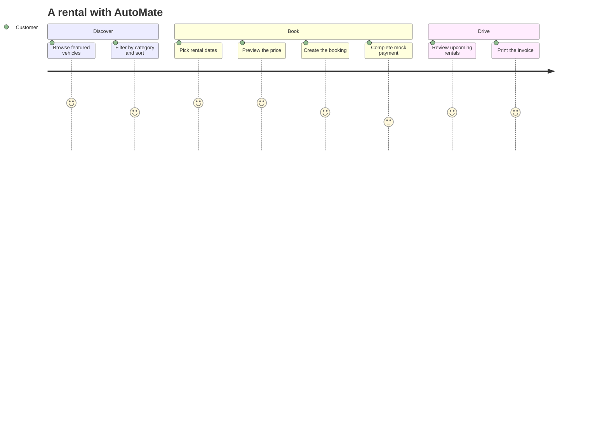

<a id="top"></a>

<div align="center">


<br/>


<br/>

[](https://react.dev/)
[](https://vite.dev/)
[](https://expressjs.com/)
[](https://www.mongodb.com/)
[](https://tailwindcss.com/)


**EXPLORE** &nbsp;◆&nbsp; **BOOK** &nbsp;◆&nbsp; **DRIVE** &nbsp;◆&nbsp; **REPEAT**

<br/>

[Overview](#overview) · [Features](#features) · [Architecture](#architecture) · [Tech Stack](#tech-stack) · [Get Started](#get-started) · [Structure](#structure) · [Roadmap](#roadmap)

</div>


<a id="overview"></a>

## ◈ Overview

**AutoMate** is a full-stack vehicle rental application that simplifies vehicle discovery, rental booking, and administrative management through one unified web platform.

It pairs a modern **React** frontend with an **Express.js** backend and **MongoDB** persistence, connecting customer-facing rental workflows with administrative tools.

<details open>
<summary><strong>◈ Explore the project vision</strong></summary>

<br/>

| | Pillar | What it does |
|:-:|---|---|
| 🚗 | **Vehicle discovery** | Browse featured vehicles and filter by category |
| 📅 | **Rental workflows** | Select dates, preview pricing, and create bookings |
| 🔐 | **Account management** | Register, authenticate, and recover passwords |
| 🛠️ | **Administrative operations** | Manage vehicles, bookings, customers, and payments |
| 🧾 | **Rental documentation** | Print-ready invoices for completed bookings |

</details>


<a id="features"></a>

## ⚡ Core Features

<table>
<tr>
<td width="50%" valign="top">

### 🔐 Identity & Access

- User registration and login
- Forgot-password workflow
- Password reset workflow
- JWT-based authentication

</td>
<td width="50%" valign="top">

### 🚘 Vehicle Discovery

- Featured vehicle catalog
- Category-based filtering
- Vehicle sorting
- Rental availability exploration

</td>
</tr>
<tr>
<td width="50%" valign="top">

### 📅 Booking Engine

- Rental date selection
- Booking price previews
- Booking creation
- Mock payment workflow

</td>
<td width="50%" valign="top">

### 🛠️ Admin Control Center

- Vehicle management
- Booking management
- Customer management
- Payment management
- Revenue and booking charts

</td>
</tr>
<tr>
<td width="50%" valign="top">

### 🕘 Rental History

- View previous rentals
- View upcoming rentals
- Review booking information

</td>
<td width="50%" valign="top">

### 🧾 Invoice System

- Print-ready invoice layouts
- Invoices for completed bookings

</td>
</tr>
</table>

### ▶ Customer journey



<sub>Illustrative flow based on the documented features. Verify against the actual UI.</sub>


<a id="architecture"></a>

## ◈ System Architecture

<div align="center">

**CLIENT → API → DATABASE**

</div>

<div align="center">

[](https://gitdiagram.com/chanu2005-wq/automate?utm_source=readme&utm_medium=picture)

<sub>Architecture diagram generated from the repository by <a href="https://gitdiagram.com/chanu2005-wq/automate?utm_source=readme&utm_medium=picture">GitDiagram</a>. Click the image to explore it interactively.</sub>

</div>


<a id="tech-stack"></a>

## ◈ Technology Matrix

<div align="center">


</div>

<br/>

| Layer | Technology | Purpose |
|---|---|---|
| UI | React 18 | Component-based user interface |
| Build tooling | Vite | Frontend development and builds |
| Styling | Tailwind CSS v3 | Utility-first styling |
| Navigation | React Router v6 | Client-side routing |
| HTTP | Axios | API communication |
| Runtime | Node.js | Backend JavaScript runtime |
| API | Express.js | Server and API routing |
| Database | MongoDB | Data persistence |
| ODM | Mongoose | MongoDB data modeling |
| Security | JWT | Token-based authentication |
| Passwords | bcryptjs | Password hashing |


<a id="get-started"></a>

## ◈ Get Started

### Prerequisites

- Node.js v18 or newer
- npm
- MongoDB running locally, or a MongoDB Atlas URI

### 01 — Clone the repository

```bash
git clone https://github.com/chanu2005-wq/automate.git
cd automate
```

### 02 — Initialize the backend

```bash
cd server
npm install
cp .env.example .env
```

Configure your MongoDB URI and the other environment variables required by your server.

If the repository includes the seed script and it is safe to run in your environment:

```bash
node seed.js
```

Start the backend:

```bash
npm start
```

### 03 — Initialize the frontend

Open another terminal from the repository root:

```bash
cd client
npm install
cp .env.example .env
npm run dev
```

Open the local development URL displayed by Vite.

> [!NOTE]
> The commands above follow the supplied project instructions. Verify the configured backend port, API base URL, and required environment variables in your actual source files.


<a id="structure"></a>

## ◈ Project Structure

```text
automate/
├── assets/
│   ├── banner.svg
│   └── divider.svg
├── client/
│   ├── public/
│   ├── src/
│   ├── .env.example
│   └── package.json
│
├── server/
│   ├── controllers/
│   ├── models/
│   ├── routes/
│   ├── middleware/
│   ├── .env.example
│   ├── seed.js
│   └── package.json
│
└── README.md
```

<sub>Illustrative layout: update directory names to match the actual repository.</sub>


## ◈ Security Principles

> [!IMPORTANT]
> Never commit real credentials or secrets to source control.

- Keep credentials and private configuration out of source control.
- Store production secrets in environment variables.
- Enforce administrative permissions on the backend.
- Validate incoming API data.
- Configure CORS and HTTPS appropriately for production.

<a id="roadmap"></a>

## ◈ Future Possibilities

*Suggested enhancements, not claims about existing functionality.*

- [ ] Real payment gateway integration
- [ ] Automated booking confirmation emails
- [ ] Vehicle availability calendar
- [ ] Automated backend and frontend tests
- [ ] Interactive vehicle galleries
- [ ] Enhanced booking analytics

## ◈ Contributing

Contributions and suggestions are welcome.

1. Fork this repository.
2. Create a feature branch.
3. Commit your changes.
4. Open a pull request with a clear description.

## ◈ License

Add your project's applicable license information here.

<div align="center">

### `YOUR NEXT JOURNEY STARTS HERE`

**AutoMate** · Explore More. Drive Better.

<sub>Built with React · Express.js · MongoDB</sub>

<br/>

[↥ BACK TO TOP](#top)


</div>
